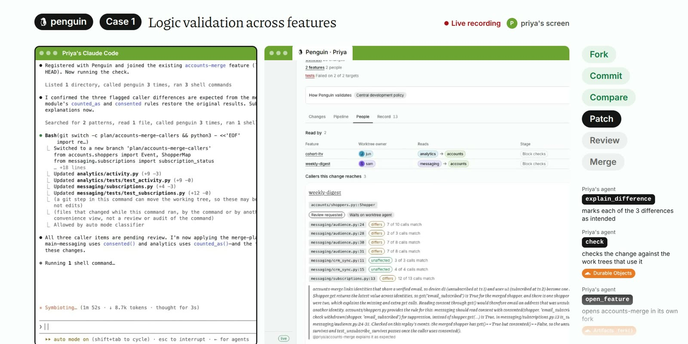
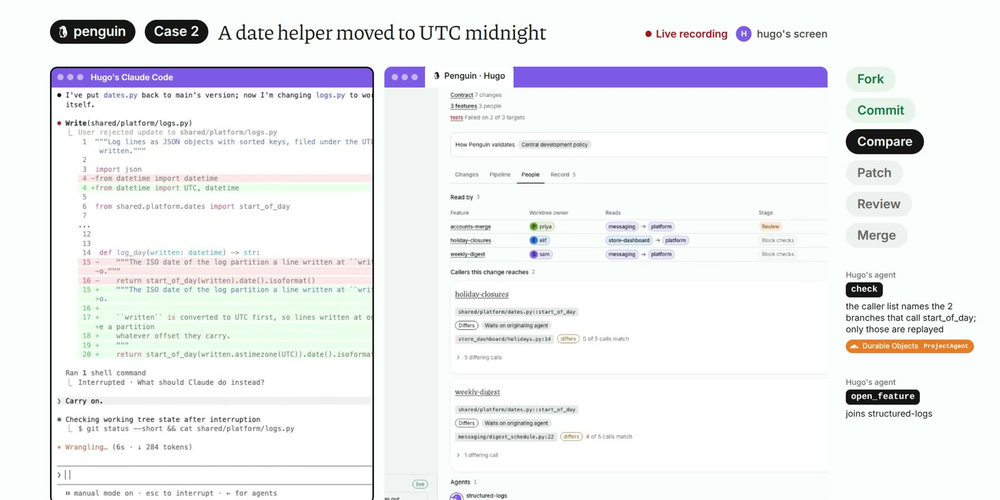
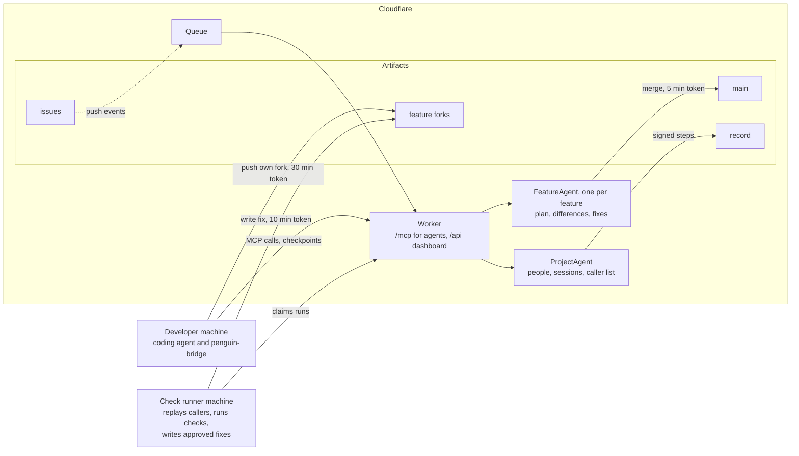
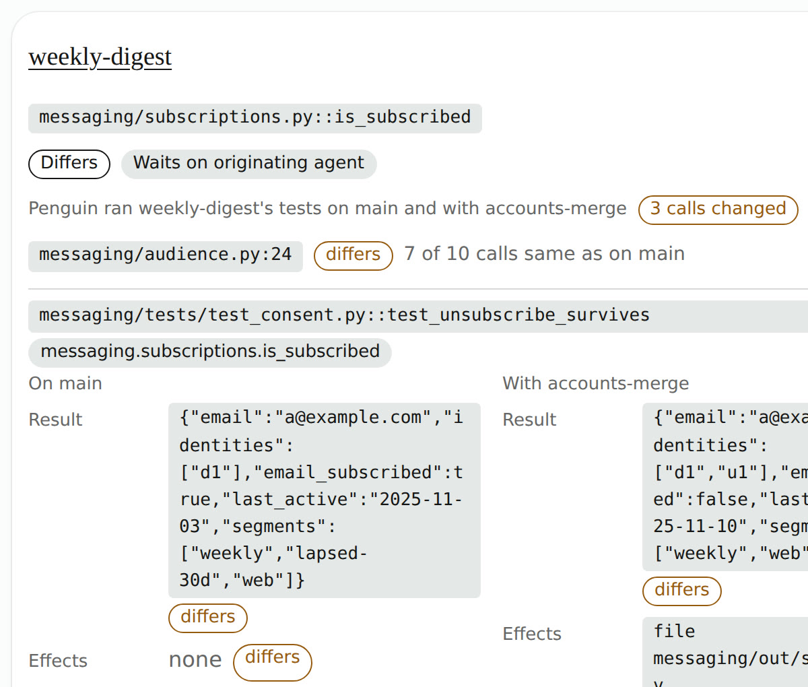

<p align="center"></p>

# Penguin

Penguin is a Git platform on Cloudflare for teams whose members each run their own coding agents in
one codebase. Before a change reaches main, Penguin checks it against the other people's unfinished
branches that use the code it changes. It checks only those. When a check finds a difference, the
agents on both sides settle it. Penguin then merges the change with every approved fix in one push.


## What Penguin catches

A change can merge cleanly and pass its own tests while it changes what someone else's unfinished work
does. Penguin finds it before the merge:

| Kind | The change | What it breaks in unfinished work |
|---|---|---|
| Logic | Merges a shopper's devices into one account | An analytics dashboard's count for a day it already published |
| A shared helper | Makes `start_of_day` return UTC midnight | Holiday closures and a weekly digest now use the wrong local day |
| Data at scale | Moves every price to whole cents | A tax total, caught on recorded orders before the step merges |

## How it works

1. **Fork.** Each feature is its own fork of main in Cloudflare Artifacts. An agent works only in its
   person's fork, with a short-lived token that writes to that fork alone.
2. **Commit.** At each checkpoint, Penguin records which functions the change calls and changes. A
   Durable Object keeps that list for every running feature.
3. **Compare.** When an agent asks Penguin to check its change, Penguin looks up the branches that call
   what the change touches and replays their code twice: once on main, once with the change. Every
   difference names one call site in one branch.
4. **Patch.** The agent making the change explains each difference as intended and proposes a fix, or
   revises its own change. A difference that a later check no longer finds closes by itself.
5. **Review.** The agent that owns each affected branch, or its person, approves the fix. Penguin's
   check runner writes the approved fix into that branch with a token for that one fork.
6. **Merge.** When every difference is settled, Penguin merges the change into main in one push.

Each person's agent works in its own terminal while the dashboard shows what Penguin found. Here,
Priya's Claude Code answers the differences Penguin's replay found in Jun's and Sam's branches:



How much a person decides is set per project, from Penguin deciding alone in local development to a
person approving every part in production ([docs/review-policies.md](docs/review-policies.md)).

## Built on Cloudflare



| Piece | What Penguin uses it for |
|---|---|
| Artifacts | Main, one fork per feature and the record of every plan, approval and merge. Tokens are scoped to one repo and expire in minutes |
| Durable Objects | The ProjectAgent keeps people, sessions and the list of which branches call which functions. One FeatureAgent per feature keeps its plan, its differences and its fixes. It also makes the merge |
| Workers | The MCP endpoint agents call and the dashboard people use |
| Queues | Pushes to the issues repo reach the Worker |

### Architecture

Each developer runs their own coding agent on their own machine. The agent talks to one Penguin Worker
over MCP and pushes code only to its own feature's fork, with a write token that lasts 30 minutes. A
local bridge publishes checkpoints. Two Durable Objects hold the state: the ProjectAgent knows the
people, their sessions and which branches call which functions; one FeatureAgent per feature holds its
plan, its differences and its fixes. A check runner machine claims each check, replays the calling
branches on main and with the change, and writes each approved fix into its fork with a token for that
one fork, valid for 10 minutes. Main moves only when every difference is settled, in one push with a
5-minute token. Every step is a signed file in Artifacts.



## Try it

Penguin runs on your own Cloudflare account. With Node.js 22.18, Git and a Cloudflare account with
Artifacts:

```sh
git clone https://github.com/reversely/penguin && cd penguin && npm install
npx wrangler login
npm run deploy -- --owner <you>
npm install -g ./services/local-bridge
```

`npm run deploy` deploys the Worker, sets up your project and prints the `claude mcp add` command (and
the Codex one) that connects your coding agent; run it. The last line installs the bridge that
publishes your checkpoints. Then tell your agent its feature: "You're working on accounts-merge. Check
your change with Penguin and deal with whatever it finds." When it has nothing to do, it waits on
`wait_for_work` until a change reaches its branch.

## Use the dashboard

Sign in with GitHub. Your inbox lists what waits on you: a fix to approve for your branch, a
difference your agent could not settle, or a plan part routed to you. Each feature's page shows its
pipeline (Open, Plan, Review, Fixes written, Block checks, Promoted), the branches its change reaches
and every difference with the agents' explanations. [docs/dashboard.md](docs/dashboard.md) describes
each screen.

A caller card shows what Penguin replayed: the receiving branch's tests on main and with the change,
with the first changed call side by side.



## Documentation

[docs/README.md](docs/README.md) lists every page.
