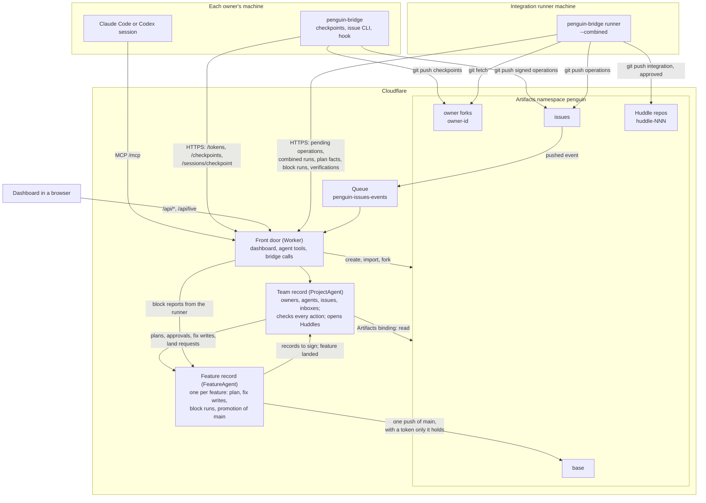

# Architecture

> **Design change.** This page describes the current build. The design in
> [design.md](design.md#pieces) changes the repos. Each feature gets its own fork `feature-*` in
> place of the per-owner forks `owner-<id>`. The build opens feature forks
> ([Opening a feature](#opening-a-feature)) and promotes each feature's block to `main`
> ([Landing a feature](#landing-a-feature)). The owner forks still carry the Huddle flow. The
> `record` repo takes over from `issues`.

Penguin gives a team whose members each run their own coding agents one shared place to coordinate:
issues that people and agents both read and write, plus a check that runs one owner's unfinished
work against every other owner's before either reaches the main branch. This page names each piece,
what it owns and how data moves between them. The other pages in this folder describe each part in
depth; [README.md](README.md) lists them.

## Pieces

Penguin keeps its state in two kinds of Durable Object on Cloudflare. The team record (`ProjectAgent`, one per
project) knows who owns what, every agent, every feature, every issue and each person's inbox. It
checks every action before accepting it and signs every record with the service key.

The feature record (`FeatureAgent`, one per feature) follows one feature from its merge plan to main:
the plan and each part's approval, the fixes written into other features' forks, the block runs that
check the feature against main and every running fork and the promotion that moves main. The check
runner's block reports reach it directly through the Worker. It asks the team record to sign each
record and to change the feature's state. Each feature has its own instance, so several features
move toward main at once.

The same class, under a Huddle's name, still runs the PRD 0.3 Huddle of an owner fork: it runs the
owners' tests together, collects each owner's review and decides when the Huddle can close. A
feature's results never open a Huddle.

| Piece | Code | Serves | Owns |
|---|---|---|---|
| Worker gateway | `apps/worker/src/` | Every caller: bridges, the runner, agent sessions, browsers | Authentication of each caller, request routing, the Queue consumer, repo setup, Artifacts token minting |
| ProjectAgent | `services/project-agent/src/` | The whole project | The issue index, operation validation, identities, sessions and routing, inboxes, bridge and MCP token registries, owner forks' latest checkpoints, combined-run scheduling, the Huddle records, features with their overlap locks and dependents |
| FeatureAgent | `services/feature-agent/src/index.ts` | One feature, or one owner-fork Huddle under a Huddle's name | The feature's plan, fix writes, block runs and promotion; a Huddle's verification runs, fix review standing, threads and approved-branch request |
| Artifacts repos | One namespace, `penguin` | Every Git client and the Worker | Versioned source and the issue operation log |
| `penguin-bridge` | `services/local-bridge/src/` | One owner on one machine | Checkpoint publishing with consent, the issue command line, the safe-checkpoint hook, the outbound spool |
| Integration runner | `penguin-bridge runner` on a designated machine | The project | Pushing queued operations, combined runs, plan facts runs, block runs, verification runs, the `approved` branch |
| Dashboard | `apps/dashboard/src/` | People in a browser | The team map, the inbox with its overlapping starts to approve, the issue page, the identities page |
| MCP tools | `services/mcp/src/tools.ts` | Agent sessions | `register_session`, `get_work`, `get_issue`, `post_update`, `report_checkpoint`, `open_feature`, `feature_token`, `declare_area`, `submit_review`, `propose_plan`, `revise_plan_part`, `fix_token`, `report_fix_write`, `land_feature` |

Shared rules live in packages that both the Worker and the bridge import: the operation schema and
wire formats in `packages/protocol`, the scope map in `packages/scope-map`, charters, review rights,
thread rights and the close rule in `packages/policies`, Git helpers in `packages/git-analysis`.
`services/issues` holds the validator, the reducer and the signature code.

## Repos in the Artifacts namespace

`apps/worker/src/repos.ts` names every repo. A deployment can set `PENGUIN_REPO_PREFIX` to keep a test
run's repos apart from production's; the prefix leads every name.

| Repo | Made by | Written by | Holds |
|---|---|---|---|
| `base` | `POST /setup`, imported from the team's Git remote or created empty | The deployer, once, when setup created it empty. Then only a FeatureAgent, to promote a block | The team's main branch, with `penguin/scopes.json`, `penguin/owners.json` and `penguin/identities.json` |
| `owner-<id>` | `POST /setup`, one fork of `base` per owner | That owner's bridge only | The owner's published checkpoints, one branch per worktree branch |
| `issues` | `POST /setup` | Every bridge and the runner | One signed file per issue operation, `issues/<issue>/ops/<op_id>.json` |
| `huddle-<id>` | The Worker, when a Huddle issue opens; `<id>` is the issue number padded to three digits, as in `huddle-031` | The runner only | The `integration` branch of each verification run and the `approved` branch at close |
| `feature-<id>` | The Worker, when a person or an agent session opens the feature (`apps/worker/src/features.ts`) | The feature's agent sessions, with tokens the Worker mints for them. For an approved merge plan part, also the plan's originating agent or the runner, with a token minted for that part | The feature's work, forked from main's branch, with each approved fix as one commit on `main` |

The Worker mints short-lived Artifacts tokens per repo (`apps/worker/src/tokens.ts`). A bridge may
hold `write` on its own fork and on `issues`. It holds `read` on every other repo, so the runner reads
a feature's fork to run its submitted reviews. A runner bridge also holds `write` on Huddle repos. An agent session holds `write` on the fork of the feature it joined,
for `PENGUIN_FEATURE_TOKEN_TTL_MINUTES`. It gets the token from `open_feature` or `feature_token`.
The Worker mints it only after the ProjectAgent confirms that the session is running and has joined
that feature. A `write` token on another person's feature fork comes only with an approved merge plan
part, for `PENGUIN_FIX_TOKEN_TTL_MINUTES`: to the plan's originating agent through `fix_token`, or to
the runner's claim of a mechanical part ([Writing an approved fix](#writing-an-approved-fix)).
Write on `base` is minted only by a FeatureAgent, for one promotion, for
`PENGUIN_PROMOTION_TOKEN_TTL_MINUTES`. It never leaves the FeatureAgent: `/tokens` holds every bridge
to `read` on `base`. No MCP tool or dashboard route mints a token on it. Once a feature's block
reaches main, every write token on its fork is revoked and none is minted again.
Artifacts tokens separate only read from write per repo, so the repo boundary is the push boundary.
The validator then decides what each operation in `issues` may do.

## Who keeps which state

The ProjectAgent keeps its state in its Durable Object's SQLite store. Most of it is derived from the
issues repo: `Issue`, `Assignment`, `Comment`, `CommentRevision`, `Mention`, `LinkedCommit`,
`IssueCheck`, `SubIssue`, `Review`, `Thread` and `AppliedOp` (`services/project-agent/src/issue-index.ts`).
`POST /index/rebuild` rebuilds those tables from the repo and compares them with the live ones.

The rest is live coordination state with no copy in Git: `PendingOp` (operations applied but not yet
pushed), identities and avatars, sessions and their routes, inbox items with read flags, registered
bridges and MCP tokens as hashes, `OwnerFork` latest checkpoints, `CombinedRun`, the Huddle records,
fix approvals and close-out blockers for the issue page. The feature tables are live state too
(`services/project-agent/src/feature-store.ts`): `Feature` holds each feature's person, fork, state
and declared area. `FeatureSession` names the agent sessions of each feature. `FeatureRecord` holds
the signed records of each opening, declaration, checkpoint update, overlap check and approval
until the record repo takes them. `OverlapLock` and `FeatureDependent`
(`services/project-agent/src/overlap-lock.ts`) hold each feature's overlap locks and the running
features that read its area. `OwnOverlap` holds overlaps with the same person's running
features, which make no lock. `OverlapSettled` records each lock that was approved or withdrawn.
`OverlapNotice` and `SettledNotice` record which sessions heard of each lock and each settlement.
`FeatureReview` (`services/project-agent/src/review-submit.ts`) holds each submitted review form. A
form that passed waits as `pending` until the check runner claims it and attaches its record
(`review-record.ts`). `AgentToolRun` (`agent-tools.ts`) holds each agent tool call. An `impact`,
`check` or `apply_fix` request waits until the check runner claims it and reports its result
(`agent-tool-runner.ts`). The row records when the requesting session's safe checkpoint delivered it.
`PlanPartRoute` (`plan-approval.ts`) keeps which revision of which plan part waits on whom.
`FixWriteGrant` (`fix-write.ts`) holds each write asked for, one per part revision, with its writer,
the fork head it must fast-forward and the commit once kept. `AnnouncedPlan` and `PlanCoverage`
(`plan-coverage.ts`) hold each feature's newest plan with its area and the running features the plan
accounts for.

Each FeatureAgent named `<project>-feature-<id>` keeps one feature's `Plan`, `PlanPart` and
`FixWrite` rows (`plan-store.ts`) and its `BlockRun`, `BlockCheck` and `Promotion` rows
(`block-store.ts`). The ProjectAgent keeps `BlockQueue`, the features whose FeatureAgent holds a run
waiting for the runner. It also keeps `PromotionSlot`, the one promotion moving main at a time
(`block-land.ts`).

A FeatureAgent named `<project>-huddle-<issue number>` keeps the state of one owner-fork Huddle:
`VerificationRun`, `FixReview`, `HuddleThread` and `ApprovedBranch`. The ProjectAgent passes it the
Huddle record with each call, together with a port back to itself. Both kinds of instance sign every
record through the ProjectAgent, so the service key stays there: a `CryptoKey` cannot cross Durable
Object RPC.

## How data flows

### Writes to issues

Three writers produce issue operations. Each path ends in the same validator and reducer, so every
operation is judged by the same rules. [issues.md](issues.md) has the detail.

1. An owner's bridge signs an operation with its own key and pushes the file to `issues`.
2. An agent session calls `post_update` over MCP, or a person acts on the dashboard. The ProjectAgent
   signs the operation with the service key, applies it at once and holds it in `PendingOp`.
3. Penguin writes its own operations as author `{"penguin": true}`, signed with the service key, also
   held in `PendingOp`.

The runner lists `PendingOp` every pass and pushes the files to `issues` in one commit. Artifacts
sends a `cf.artifacts.repo.pushed` event for every push to `issues` to the Queue. The Worker's queue
handler (`apps/worker/src/push-events.ts`) passes the push to the ProjectAgent, which reads the new
files through the Artifacts binding and applies them in coordination order. A pushed file that
matches a pending operation clears its `PendingOp` row.

### Opening a feature

1. An agent session calls `open_feature`, or a person posts to `POST /api/features`. The Worker
   passes the request to the ProjectAgent. The ProjectAgent checks the feature id and the paths. It
   checks the scopes and contracts against `penguin/scopes.json` on main. It stores the feature with a
   signed `open_feature` record and makes the session an agent of the feature. It then compares the
   area with every running feature. Each feature that covers part of the area gets an
   `OverlapLock` and an inbox item for its person. Each feature that reads the area through a scope
   dependency is stored as a dependent. A signed `overlap_check` record states both.
2. While the feature has no fork, the Worker forks the `base` repo into `feature-<id>` and records
   the fork. An existing repo counts as forked, so a second open makes no second fork.
3. For a session, the Worker asks the ProjectAgent for a grant and mints a `write` token on
   `feature-<id>`. The token goes back in the tool's answer and nowhere else. While a lock is open
   the ProjectAgent grants nothing. The covering person approves on the dashboard through
   `POST /api/overlaps/approve`. The Worker names the approver from the session. The ProjectAgent
   checks that this person owns the covering feature and writes a signed `approve_overlap`
   record. The session's next `feature_token` call then gets its token.
4. Each checkpoint on the fork, from `report_checkpoint` or the bridge's `POST /checkpoints`, must be
   in the fork. The ProjectAgent diffs it against its baseline on main and adds the changed paths
   and their scopes to the declared area.

### Writing an approved fix

1. An author approves a part of a merge plan on their running feature on the dashboard. A mechanical
   part's approval queues a write for the runner.
2. The plan's originating agent calls `fix_token`, or the runner claims the queued write at
   `POST /fix-writes/claim`. The ProjectAgent checks that the part's current revision is approved and
   unwritten and that the patch writes only paths inside the part. It reads the affected fork's head
   through the Artifacts binding. A head that moved past the patch's base still takes the write when
   the patch applies there unchanged. Otherwise the part goes back to the originating agent to revise.
   The Worker then mints a `write` token on that one fork.
3. The writer's bridge fetches the fork, makes one commit of the patch on the head with the message
   Penguin built and pushes it to `main` with no force (`penguin-bridge fix-write`, or runner mode).
4. The writer reports the commit with `report_fix_write` or `POST /fix-writes/<write id>`. The
   ProjectAgent reads it back and keeps it as a signed `fix_write` record when it is exactly the
   approved patch on the granted head. No branch or repo is made.

[design.md](design.md#steps-1-and-3-in-the-build) has the rules.

### Landing a feature

1. The feature's agent calls `land_feature`. The ProjectAgent checks that the feature's latest
   checkpoint already holds main's head and that every part of its plan is approved. Each fix for a
   running feature must be written and still under that fork's head. Each fix for code on main must be
   in the checkpoint. It then asks the FeatureAgent to open a block run: the checkpoint merged onto
   main and onto every other running feature's fork head. The feature is `landing`.
2. The runner claims the run at `POST /blocks/claim`, runs the checks with every scope's tests on
   main's merged tree and reports to `POST /blocks/<feature>/<n>`. The Worker hands the report to the
   FeatureAgent, which keeps it as a signed `block_checked` record.
3. A failing check sends the feature back to `building` with one next step per failure, which the
   agent reads in `get_work`. When every check passes, the FeatureAgent takes the project's promotion
   slot. It mints a write token on `base` and a read token on the fork, moves main from the checked
   head to the checkpoint in one push and revokes both tokens. Main that moved in the meantime refuses
   the push: Penguin checks the block again on the new main, or returns it to the agent to take main.
4. The promotion is a signed `promotion` record. The fork's write tokens are revoked and the feature is
   `landed`.

A checkpoint of a running feature whose area meets another feature's announced plan asks for a
`plan_check` run of that plan's block. It runs the same checks and never moves main.
[design.md](design.md#block-promotion-in-the-build) has the rules.

### Checkpoints to Huddles

1. An owner's bridge pushes a checkpoint to `owner-<id>` after the owner consents, then reports it
   on `POST /checkpoints`. An agent session can report the same checkpoint through
   `report_checkpoint`.
2. The ProjectAgent confirms the commit exists in that fork, records it as the fork's latest
   checkpoint and schedules a combined run for each running feature, or owner fork, that reads a
   scope the checkpoint changed. Each of a person's features is a run of its own.
3. The runner claims the runs, merges the checkpoints, runs the allowlisted tests and reports the
   results. A failure opens a Huddle issue with one fix sub-issue per failing test.
4. Fix tasks reach agent sessions at safe checkpoints. Each newer checkpoint of an owner in the Huddle
   schedules a verification run on the Huddle repo's `integration` branch.
5. When the tests pass, the Huddle's FeatureAgent asks the owners whose review counts to review each fix. Once
   every fix is approved and every thread resolved, the runner records the `approved` branch and
   Penguin closes the issue.

[huddle-flow.md](huddle-flow.md) walks through every step.

### Live updates

The dashboard opens a WebSocket at `/api/live`. The Worker forwards it to the ProjectAgent with the
signed-in person's owner id in the `X-Penguin-Owner` header. The agent sends a message naming the
changed issues and sessions after each change; the dashboard then reads what it shows again through
the API. The socket never carries issue data (`packages/protocol/src/live.ts`).

## Outbound connections only

Every connection from an owner's machine starts there. The bridge calls the Worker over HTTPS and
talks Git to Artifacts with a token it fetched. Agent sessions call `/mcp`. Penguin never connects
to an owner's machine and never starts, reads or wakes an agent:
[how-agents-connect.md](how-agents-connect.md) describes the three ways Penguin reaches an agent.

## Model calls

No code path calls a model. Penguin writes every operation it authors from a template over typed
events: the Huddle opening (`huddle-open.ts`), verification (`huddle-verify.ts`), reviews
(`huddle-reviews.ts`), threads (`huddle-threads.ts`) and close-out (`huddle-close.ts`).
