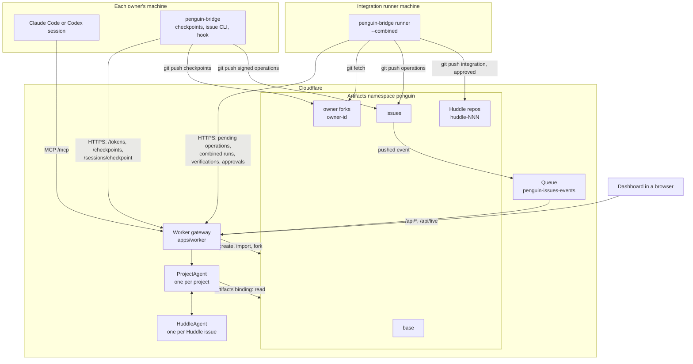

# Architecture

Penguin gives a team whose members each run their own coding agents one shared place to coordinate:
issues that people and agents both read and write, plus a check that runs one owner's unfinished
work against every other owner's before either reaches the main branch. This page names each piece,
what it owns and how data moves between them. The other pages in this folder describe each part in
depth; [README.md](README.md) lists them.

## Pieces

| Piece | Code | Serves | Owns |
|---|---|---|---|
| Worker gateway | `apps/worker/src/` | Every caller: bridges, the runner, agent sessions, browsers | Authentication of each caller, request routing, the Queue consumer, repo setup, Artifacts token minting |
| ProjectAgent | `services/project-agent/src/` | The whole project | The issue index, operation validation, identities, sessions and routing, inboxes, bridge and MCP token registries, owner forks' latest checkpoints, combined-run scheduling, the Huddle records |
| HuddleAgent | `services/huddle-agent/src/index.ts` | One Huddle issue | That Huddle's verification runs, fix review standing, threads and approved-branch request |
| Artifacts repos | One namespace, `penguin` | Every Git client and the Worker | Versioned source and the issue operation log |
| `penguin-bridge` | `services/local-bridge/src/` | One owner on one machine | Checkpoint publishing with consent, the issue command line, the safe-checkpoint hook, the outbound spool |
| Integration runner | `penguin-bridge runner` on a designated machine | The project | Pushing queued operations, combined runs, verification runs, the `approved` branch |
| Dashboard | `apps/dashboard/src/` | People in a browser | The team map, the inbox, the issue page, the identities page |
| MCP tools | `services/mcp/src/tools.ts` | Agent sessions | `register_session`, `get_work`, `get_issue`, `post_update`, `report_checkpoint` |

Shared rules live in packages that both the Worker and the bridge import: the operation schema and
wire formats in `packages/protocol`, the scope map in `packages/scope-map`, charters, review rights,
thread rights and the close rule in `packages/policies`, Git helpers in `packages/git-analysis`.
`services/issues` holds the validator, the reducer and the signature code.

## Repos in the Artifacts namespace

`apps/worker/src/repos.ts` names every repo. A deployment can set `PENGUIN_REPO_PREFIX` to keep a test
run's repos apart from production's; the prefix leads every name.

| Repo | Made by | Written by | Holds |
|---|---|---|---|
| `base` | `POST /setup`, imported from the team's Git remote or created empty | The deployer, once, when setup created it empty | The team's main branch, with `penguin/scopes.json`, `penguin/owners.json` and `penguin/identities.json` |
| `owner-<id>` | `POST /setup`, one fork of `base` per owner | That owner's bridge only | The owner's published checkpoints, one branch per worktree branch |
| `issues` | `POST /setup` | Every bridge and the runner | One signed file per issue operation, `issues/<issue>/ops/<op_id>.json` |
| `huddle-<id>` | The Worker, when a Huddle issue opens; `<id>` is the issue number padded to three digits, as in `huddle-031` | The runner only | The `integration` branch of each verification run and the `approved` branch at close |

The Worker mints short-lived Artifacts tokens per repo (`apps/worker/src/tokens.ts`). A bridge may
hold `write` on its own fork and on `issues`. It holds `read` on every other repo. A runner bridge also
holds `write` on Huddle repos. Artifacts tokens separate only read from write per repo, so the repo
boundary is the push boundary. The validator then decides what each operation in `issues` may do.

## Who keeps which state

The ProjectAgent keeps its state in its Durable Object's SQLite store. Most of it is derived from the
issues repo: `Issue`, `Assignment`, `Comment`, `CommentRevision`, `Mention`, `LinkedCommit`,
`IssueCheck`, `SubIssue`, `Review`, `Thread` and `AppliedOp` (`services/project-agent/src/issue-index.ts`).
`POST /index/rebuild` rebuilds those tables from the repo and compares them with the live ones.

The rest is live coordination state with no copy in Git: `PendingOp` (operations applied but not yet
pushed), identities and avatars, sessions and their routes, inbox items with read flags, registered
bridges and MCP tokens as hashes, `OwnerFork` latest checkpoints, `CombinedRun`, the Huddle records,
fix approvals and close-out blockers for the issue page.

Each HuddleAgent keeps the state of one Huddle in its own SQLite store: `VerificationRun`,
`FixReview`, `HuddleThread` and `ApprovedBranch`. The ProjectAgent names the instance
`<project>-huddle-<issue number>` and passes it the Huddle record with each call, together with a port
back to itself. The HuddleAgent writes every issue operation through that port, so the service key
stays in the ProjectAgent: a `CryptoKey` cannot cross Durable Object RPC.

## How data flows

### Writes to issues

Three writers produce issue operations. Each path ends in the same validator and reducer, so every
operation is judged by the same rules. [issues.md](issues.md) has the detail.

1. An owner's bridge signs an operation with its own key and pushes the file to `issues`.
2. An agent session calls `post_update` over MCP, or a person acts on the dashboard. The ProjectAgent
   signs the operation with the service key, applies it at once and holds it in `PendingOp`.
3. Penguin writes its own operations as author `{"penguin": true}`, signed with the service key, also
   held in `PendingOp`.

The runner lists `PendingOp` every pass and pushes the files to `issues` in one commit. Artifacts
sends a `cf.artifacts.repo.pushed` event for every push to `issues` to the Queue. The Worker's queue
handler (`apps/worker/src/push-events.ts`) passes the push to the ProjectAgent, which reads the new
files through the Artifacts binding and applies them in coordination order. A pushed file that
matches a pending operation clears its `PendingOp` row.

### Checkpoints to Huddles

1. An owner's bridge pushes a checkpoint to `owner-<id>` after the owner consents, then reports it
   on `POST /checkpoints`. An agent session can report the same checkpoint through
   `report_checkpoint`.
2. The ProjectAgent confirms the commit exists in that fork, records it as the fork's latest
   checkpoint and schedules a combined run for each owner whose scope depends on a scope the
   checkpoint changed.
3. The runner claims the runs, merges the checkpoints, runs the allowlisted tests and reports the
   results. A failure opens a Huddle issue with one fix sub-issue per failing test.
4. Fix tasks reach agent sessions at safe checkpoints. Each newer checkpoint of an owner in the Huddle
   schedules a verification run on the Huddle repo's `integration` branch.
5. When the tests pass, the HuddleAgent asks the owners whose review counts to review each fix. Once
   every fix is approved and every thread resolved, the runner records the `approved` branch and
   Penguin closes the issue.

[huddle-flow.md](huddle-flow.md) walks through every step.

### Live updates

The dashboard opens a WebSocket at `/api/live`. The Worker forwards it to the ProjectAgent with the
signed-in person's owner id in the `X-Penguin-Owner` header. The agent sends a message naming the
changed issues and sessions after each change; the dashboard then reads what it shows again through
the API. The socket never carries issue data (`packages/protocol/src/live.ts`).

## Outbound connections only

Every connection from an owner's machine starts there. The bridge calls the Worker over HTTPS and
talks Git to Artifacts with a token it fetched. Agent sessions call `/mcp`. Penguin never connects
to an owner's machine and never starts, reads or wakes an agent:
[how-agents-connect.md](how-agents-connect.md) describes the three ways Penguin reaches an agent.

## Model calls

No code path calls a model. Penguin writes every operation it authors from a template over typed
events: the Huddle opening (`huddle-open.ts`), verification (`huddle-verify.ts`), reviews
(`huddle-reviews.ts`), threads (`huddle-threads.ts`) and close-out (`huddle-close.ts`).
