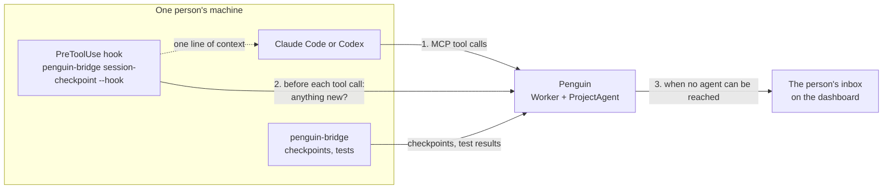

# How Penguin reaches each person's agents

Each person on a team runs their own Claude Code or Codex on their own machine. Penguin's server
never runs, starts or reads those agents. It reaches them by three paths only. The one program that
starts an agent is the person's own bridge: while the person runs `penguin-bridge edits`, it runs an
edit task no session took as a headless run on their machine
([bridge-and-runner.md](bridge-and-runner.md#edit-tasks)). [README.md](README.md)
lists the other docs; [architecture.md](architecture.md) places these paths among Penguin's pieces.

## 1. The agent asks Penguin

Each person adds Penguin to their agent as an MCP server: one server address and that person's own
MCP token. Configuration for both products is in [mcp-setup.md](mcp-setup.md). The agent then has
these tools, among others:

| Tool | What the agent uses it for |
|---|---|
| `register_session` | Says which of its person's agent identities it works as, such as `@jun/reports` |
| `get_work` | Reads the issues and fix tasks assigned to that identity; also the threads and overlapping starts that need its person and whether its feature waits to start |
| `get_work_item` | Reads the details of one entry `get_work` listed, such as a caller item or a plan part |
| `wait_for_work` | Holds while the agent has nothing to do, in place of ending its turn; answers with the `get_work` entries that arrive, or `waiting` after at most 50 seconds ([mcp-setup.md](mcp-setup.md#waiting-for-new-work)) |
| `get_issue` | Reads one issue in full |
| `post_update` | Comments, links a commit, changes state, replies in a thread, sends a fix upstream |
| `report_checkpoint` | Reports a checkpoint on its person's owner fork or on its feature's fork; the answer lists any task or thread that arrived |
| `open_feature` | Opens a feature, or joins one its person already opened, with a declared area; the answer carries a short-lived write token on the feature's fork, or lists the running features whose people must approve first |
| `feature_token` | Gets a fresh write token on its feature's fork once no overlap lock holds its start |
| `declare_area` | Replaces its feature's declared scopes, paths and contracts |
| `submit_review` | Submits the review form for its own scope on another feature's change; the answer keeps it pending for the check runner or lists every reason it is refused |
| `whats_near`, `impact`, `check`, `apply_fix` | Asks for the running features near some paths or scopes, the impact of its checkpoint, the checks of its change merged onto other forks, or one deterministic fix |
| `propose_plan`, `revise_plan_part` | Proposes its feature's merge plan, or revises one part a person asked to change |
| `land_feature` | Asks Penguin to check its feature's block and move main to its latest checkpoint |
| `confirm_caller`, `review_caller`, `propose_caller_fix`, `explain_difference` | Answers a caller item: the receiving side confirms or reviews, the originating side proposes a fix or explains a difference |
| `fix_token`, `report_fix_write` | Gets a write token for one approved part's fix and reports the commit, only for a write Penguin opened for the originating agent before its check runner wrote every part; the runner writes every other approved part |

Penguin answers only when the agent calls a tool. The token decides whose identities the session may
use: Sam's token cannot register as `@jun/reports`.

## 2. A note before the agent's next step

An agent that is busy does not call `get_work` on its own. Claude Code and Codex both run command
hooks before each tool call. The project's hook settings run `penguin-bridge session-checkpoint --hook`
there. The hook asks Penguin whether anything new is waiting for this session:

- Nothing waiting: the hook prints nothing and the tool call goes ahead.
- A fix task, a thread or a check runner result arrived: the hook adds one line to the agent's context telling it to call
  `get_work`. The agent reads the task at that point, between two steps, never in the middle of one.
- Penguin unreachable: the hook stays silent and the tool call goes ahead.

This path reaches an agent that keeps working without anyone typing. The hook settings for both
products are in [mcp-setup.md](mcp-setup.md#fix-tasks-and-safe-checkpoints).

## 3. The person's inbox

An agent with nothing to do calls `wait_for_work`. Penguin answers that call when new work arrives,
or with `waiting` after at most 50 seconds, and the agent calls again. An agent that is not running,
or that ended its turn to wait for its person, makes no tool calls, so neither path above reaches
it. Penguin cannot start an agent or a new turn. On a Claude plan nothing can
post into a session's window from outside. Penguin puts the item in the person's inbox on the
dashboard instead, marked with what it waits for: "Session to start" for a task assigned to an
identity with no running session, "Reply" for a thread, "Review" for a fix
(`apps/dashboard/src/inbox-view.ts`). The person then starts a
session or tells their agent.

## What each person installs

| Piece | Where | What it does |
|---|---|---|
| `penguin-bridge` | Their machine, from this repo (`services/local-bridge`; see [bridge-and-runner.md](bridge-and-runner.md)) | Publishes their checkpoints to Penguin after showing them the exact changes, runs the project's allowed test commands, provides the hook command, runs edit tasks headless with `penguin-bridge edits` |
| One MCP server entry | Their Claude Code or Codex settings | Path 1 |
| One hook entry | The project's `.claude/settings.json` or `.codex/hooks.json` | Path 2 |
| A dashboard sign-in | Their browser, through GitHub | Path 3 |

## What Penguin does not do

- Read an agent's conversation: transcripts stay on the person's machine.
- Start or stop an agent session, or start a turn in one: it answers only a tool call the agent
  made, `wait_for_work` included.
- Push code for an agent: each agent's work reaches Penguin only as a checkpoint its person's bridge
  publishes.
