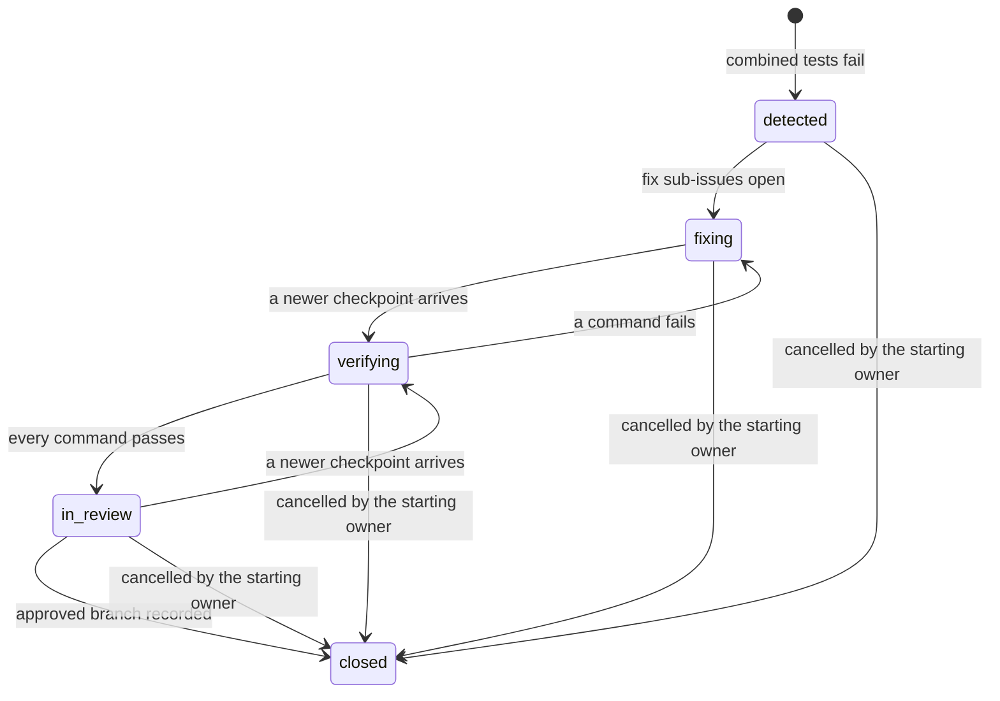

# Huddle flow

A Huddle is the issue Penguin opens when one owner's checkpoint breaks another owner's tests before
either change reaches the main branch. It brings in only the owners whose work is involved, hands
each fix to the agent session that should make it and closes once the affected owners approve. This
page follows a Huddle from the checkpoint that triggers it to its close.
[architecture.md](architecture.md) places the pieces named here; [issues.md](issues.md) defines the
operations each step writes.

Penguin writes every operation in this flow as author `{"penguin": true}` from templates in
`services/project-agent/src/`. No step calls a model.

## States



## Worked examples

Three fixtures under `examples/` reproduce the three use cases. `npm run walkthrough` runs each one
through the real Worker ([walkthrough.md](walkthrough.md)). The steps below use the first.

| Fixture | Trigger | Fixes | Upstream |
|---|---|---|---|
| [Identity unification](fixture.md) | Priya's merge rules for `person_id` in `identity-map` | Jun fixes `test_dau_stable`; Priya fixes `test_shared_device_split`; Sam fixes `test_unsubscribe_survives` | Jun's session sends `test_shared_device_split` upstream to Priya |
| [Helpful fix](fixture-helpful-fix.md) | Priya's UTC `start_of_day()` in `ingestion` | Jun and Sam each switch to Priya's `start_of_local_day()` | None |
| [Dependency bump](fixture-dependency-bump.md) | Hugo's wire 2.0.0 upgrade in `platform` | Ana adds idempotency keys in `payments` | None |

## 1. Checkpoint report

An owner's bridge publishes a checkpoint to the owner's fork `owner-<id>` after the owner consents
([bridge-and-runner.md](bridge-and-runner.md#checkpoint-publishing)). The bridge then reports it on
`POST /checkpoints`; an agent session may report the same commit through `report_checkpoint`. The
ProjectAgent records the commit as the fork's latest checkpoint only after it finds the commit in
that owner's fork (`services/project-agent/src/owner-forks.ts`).

In the identity-unification fixture, Priya's bridge publishes `owner-priya-checkpoint`, which changes
`ingestion/identity_map.py` in the `identity-map` scope.

## 2. Combined-run scheduling

The scope map in the base repo's `penguin/scopes.json` lists each scope's owner, paths, test command
and `depends_on` entries:

```json
{
  "id": "analytics",
  "name": "Analytics models",
  "owner": "jun",
  "paths": ["analytics/"],
  "test_command": "python -m pytest analytics",
  "depends_on": [{ "scope": "identity-map", "kind": "imports" }]
}
```

For each recorded checkpoint, `scheduleCombinedRuns` (`services/project-agent/src/combined-run-schedule.ts`):

1. Finds the checkpoint's baseline: the newest commit on its first-parent chain that is also on the
   base repo's `main`.
2. Diffs the baseline against the checkpoint and maps the changed paths to scopes.
3. Collects every scope that depends on a changed scope, grouped by its owner, leaving out the
   checkpoint's own owner.
4. Schedules one run per dependent owner: the trigger checkpoint, that owner's latest checkpoint and
   one command id `test:<scope id>` per dependent scope. A dependent owner with no checkpoint yet gets
   no run.

A run is keyed by the trigger and the dependent owner's checkpoint, so reporting the same checkpoint
twice schedules nothing new. A project with no `depends_on` entry reads no Git at all.

Priya's checkpoint changes `identity-map`. `analytics` (Jun) and `messaging` (Sam) depend on it, so
Penguin schedules a run for Jun with `test:analytics` and one for Sam with `test:messaging`.

## 3. Combined runs on the runner

The integration runner, `penguin-bridge runner --combined`, calls `POST /combined-runs/claim` on each
pass. A claim hands out the runs of up to 8 triggers and holds them for 30 minutes; an unreported run
is handed out again after that. For each trigger the runner:

1. Fetches the trigger's and each dependent owner's fork with read tokens into its own repository.
2. Resolves each command id from `penguin/scopes.json` as committed at the trigger checkpoint. An id
   with no scope there is refused and never runs (`services/local-bridge/src/command-allowlist.ts`).
3. Merges the trigger with the dependent owner's checkpoint with `git merge-tree --write-tree`. A
   conflicting merge runs no tests and reports `conflict`.
4. Runs each scope's `test_command` on the merged commit in a throwaway worktree, then removes it.
5. Reads the failing tests from pytest's `FAILED <node id>` lines and fingerprints each result.
6. Reports every result for the trigger in one `POST /combined-runs`.

Penguin sends command ids only. The shell command always comes from the repository's own config at
the pinned commit.

## 4. Huddle opening

`openHuddle` (`services/project-agent/src/huddle-open.ts`) opens a Huddle only for a failed result
whose trigger commit is in its owner's fork. A passing report opens nothing. A conflict also opens
nothing: only failing tests make fix sub-issues. A second report of the same trigger finds the Huddle
already open and writes nothing.

On the Huddle issue, Penguin writes:

- the create, then state `detected`;
- the `huddle` label and one `scope:<id>` label per changed and failing scope;
- the trigger commit as a `trigger` link;
- one check per failing test, with its fingerprint;
- a mention of the trigger's owner and each owner whose test failed, which puts the Huddle in their
  inboxes and nobody else's;
- a thread anchored `unassigned-impact` when changed paths fall in no scope, asking the project's
  owners to assign one;
- state `fixing` once every fix sub-issue is open.

Each failing test gets one fix sub-issue: a create, a `scope:<failing scope>` label, the dependent
owner's checkpoint linked, the same check and an assignee. The default assignee (`fixAssignee`) is
the identity whose session reported the tested checkpoint. Failing that, it is the owner's first
identity by handle whose charter holds the failing scope; failing that, the owner in person.

The Worker then forks `huddle-<id>` from the base repo. A failed fork leaves the issue open and the
next report of the trigger forks again.

In the identity-unification fixture this opens one Huddle with three fix sub-issues: two assigned to
`@jun/reports` and one to `@sam/campaigns`.

## 5. Fix delivery at safe checkpoints

An assigned fix sub-issue routes to a running session of its identity
(`services/project-agent/src/session-store.ts`). The session reads it through `get_work` only from
its next safe checkpoint on, so the task never arrives in the middle of a step. A safe checkpoint is:

| Checkpoint | Sent by |
|---|---|
| Registering | The agent's `register_session` call |
| Before the agent's next tool action | The bridge's PreToolUse hook, `penguin-bridge session-checkpoint --hook` |
| A reported checkpoint | The agent's `report_checkpoint` call |
| A bridge publish | `penguin-bridge checkpoint`, after it pushes |
| By hand | `penguin-bridge session-checkpoint` in the worktree |

`get_work` gives a fix task its pinned base (the trigger, its baseline and the checkpoint to start
from), the failing test with its fingerprint and the acceptance criteria (`fix-task.ts`). With no
running session of the identity, the owner's inbox gets a "start a session" item and the issue stays
in `fixing`. A session that goes offline leaves the sub-issue open and assigned; the next session of
the identity receives it when it registers.

An identity that does not accept assignments automatically waits for its owner's acceptance before
anything routes to it. No route or dashboard control accepts an assignment yet, so check
"Auto-accept assignments" on every identity that should receive fix tasks.

[how-agents-connect.md](how-agents-connect.md) shows how the task reaches the agent;
[mcp-setup.md](mcp-setup.md#fix-tasks-and-safe-checkpoints) has the hook settings.

## 6. Send upstream and reassignment

A session can find that its fix belongs in the scope the trigger changed, outside its identity's
charter. It calls `post_update` with `{"type": "send_upstream", "reason": "..."}` on the fix
sub-issue. The validator and reducer refuse three cases and record each refusal on the issue:
`not_assignee`, `not_a_fix` and `inside_charter`.

Once the `send_upstream` applies, `reassignUpstream` (`services/project-agent/src/upstream.ts`):

1. Picks the upstream owner: the owner of the trigger's changed scopes outside the sender's charter,
   preferring the trigger's owner.
2. Labels the sub-issue with that scope, so that owner's review counts on it.
3. Assigns the upstream owner's identity whose charter holds those scopes, preferring one with a
   running session, else the owner in person.
4. Unassigns the sender.

The task then reads in the new assignee's terms: it pins the trigger and asks for a fixed checkpoint
of the new owner that makes the dependent owner's test pass. The tool's answer names the new assignee
under `reassignment`.

In the identity-unification fixture, `@jun/reports` sends the shared-device fix upstream and Penguin
reassigns it to `@priya/merge-rules`.

## 7. Verification on the integration branch

Each newer checkpoint of an owner in an open Huddle schedules verification in that Huddle's
HuddleAgent (`services/project-agent/src/huddle-verify.ts`). On the Huddle issue, Penguin:

1. Links the new checkpoint as a `fix` commit and, in the same operation, marks every current check
   superseded. A superseded check no longer counts toward the close.
2. Moves the issue to `verifying`.
3. Schedules one run. The run merges the latest checkpoint of every owner in the Huddle, trigger
   owner first. It runs a test command for every scope the trigger changed or that depends on one. Any earlier run not yet
   reported is marked superseded.

The runner lists runs on `GET /verifications`. For each, it merges the listed checkpoints onto the
run's base with `git merge-tree`, pushes the result to the Huddle repo's `integration` branch, runs
each command there in a throwaway worktree and reports to `POST /verifications/<run id>`. A report for
a superseded run answers 409 and never counts.

Penguin attaches one check per command, or per failing test, on `huddle-<id>@<integration sha>`. The
issue moves to `in_review` when every command passes and back to `fixing` otherwise: a clean Git
merge whose tests fail keeps the issue out of review.

## 8. Reviews and review rights

When the combined tests pass, the HuddleAgent collects reviews (`huddle-reviews.ts`). On each fix
sub-issue, Penguin links the fixing owner's checkpoint that the passing run merged as the fix's head,
a `fix` commit. It then asks each owner whose review counts to review that head, through a "review
requested" inbox item. A newer head asks again, because a review of an older commit no longer counts.

Whose review counts (`packages/policies/src/review-rights.ts`):

- the owner of each scope labelled on the fix sub-issue: the failing test's scope, plus the changing
  scope once the fix went upstream;
- the delegate of such an owner, named as `delegate_owner_id` in the base repo's
  `penguin/owners.json`. A delegate's review stands for the owner who named them.

Identities and Penguin hold no review right. A review from anyone else is kept on the issue as a
review that does not count. A fix is approved once every owner whose review counts has approved its
current head (`packages/policies/src/fix-approval.ts`).

Owners review on the issue page's approval cards with Approve and Request changes, or from the bridge
with `penguin-bridge issue review`.

## 9. Threads

A counting review that requests changes opens a thread on the fix sub-issue
(`huddle-threads.ts`). The thread's body is the reviewer's reason, its anchor is
`review:<review op_id>` and it needs the owners of the fix's assignees other than the reviewer.

From there:

- Each person the thread needs gets a "thread" inbox item.
- Each of those people's running sessions hears of it once, at its next safe checkpoint. The hook
  answer names the issue; `report_checkpoint` lists it under `newThreads`.
- `get_work` lists every open thread that needs the session's developer under `threadsNeedingYou`.
  The agent tells its developer in its own conversation.
- Agents reply with `post_update` (`reply_thread`); people reply on the issue page.

A thread's people are the people it needs, the people behind everyone who opened, replied to or
resolved it, plus the reviewer whose request opened it. Only those people may resolve it, in person
(`packages/policies/src/thread-rights.ts`). An open thread keeps the Huddle in review.

In the identity-unification fixture, Jun requests changes on the upstream fix because a limit of five
still joins the tablet's users. Priya's session sees the thread, Priya lowers the limit and Jun
resolves the thread.

## 10. Close as approved

After each review, check or thread change, the HuddleAgent evaluates the close (`huddle-close.ts`).
Nothing may stand in the way (`closeBlockers` in `packages/policies/src/huddle-close.ts`):

- the Huddle issue is in `in_review`;
- every current check passes, all on one revision of `huddle-<id>`'s integration branch;
- every fix is approved on its head;
- no thread on the Huddle issue or its fixes is open.

The issue page's Close-out panel lists whatever still blocks the close. When nothing does:

1. The HuddleAgent asks the runner to point the Huddle repo's `approved` branch at the verified
   integration commit. The Worker cannot write a Git ref through the Artifacts binding, so the runner
   does it.
2. The runner lists the request on `GET /approvals`, pushes `approved` and reports on
   `POST /approvals/<issue>`. A report of a commit no longer requested answers 409.
3. The HuddleAgent evaluates again. If nothing changed, Penguin links the commit as `approved` and
   closes the Huddle with resolution `approved`.

The index applies the same rule to the close operation itself, so a close that slips past a change is
refused with `close_blocked` and recorded. Fix sub-issues stay open after the Huddle closes. Nothing
in this flow touches the team's main branch: approving the candidate and merging it stay separate.

## 11. Cancel

The owner whose checkpoint started the Huddle may close it at any state with resolution `cancelled`,
in person. Anyone else's cancel is refused with `not_starting_owner` and recorded. The dashboard has
no cancel control; the owner cancels from the bridge:

```sh
penguin-bridge issue state --owner priya --issue 31 --state closed \
  --reason "Reverting the merge rules" --resolution cancelled
```
